# Arkitektur

Visuel reference for hvordan Grundtone Studio hænger sammen med det open source design system og
kundens app. Komplementerer [MVP.md](./MVP.md).

---

## 1. Overblik

```mermaid
flowchart TB
    %% ═══════════════════════════════════════════════
    %% TOP: TWO REPOS
    %% ═══════════════════════════════════════════════
    subgraph PublicRepo["🌍 KlangHaus/grundtone — PUBLIC repo (OSS, MIT)"]
        direction LR
        DSCore["@grundtone/core<br/>applyThemeToDOM"]
        DSVue["@grundtone/vue<br/>komponenter"]
        DSNuxt["@grundtone/nuxt"]
        DSTokens["@grundtone/design-tokens"]
        DSIcons["@grundtone/icons"]
        DSUtils["@grundtone/utils"]
        DSRN["@grundtone/react-native"]
    end

    subgraph PrivateRepo["🔒 KlangHaus/grundtone-studio — PRIVATE monorepo"]
        direction TB
        subgraph StudioApp["apps/studio/  · Nuxt 3 SaaS"]
            UI["Token-editor UI<br/>Org/Project/Member-management<br/>Publish-pipeline"]
            Auth["Better Auth<br/>(organization plugin)"]
            ServerAPI["Nitro server routes<br/>API for CRUD + publish"]
        end
        subgraph SDKPkg["packages/saas-client/"]
            SDK["@grundtone/saas-client<br/>fetch + applyThemeToDOM<br/>Vue plugin · script-tag · ESM"]
        end
    end

    %% ═══════════════════════════════════════════════
    %% MIDDLE: INFRASTRUCTURE
    %% ═══════════════════════════════════════════════
    subgraph Infra["☁️ UpCloud (EU) + Bunny.net"]
        direction LR
        DB[("PostgreSQL<br/>org · project · member<br/>api_key · config_version<br/>active_version")]
        Blob[("Object Storage<br/>k/{prefix}/v{n}/<br/>tokens.json · tokens.css")]
        CDN["Bunny.net CDN<br/>cdn.grundtone.io"]
    end

    %% ═══════════════════════════════════════════════
    %% BOTTOM: CUSTOMER
    %% ═══════════════════════════════════════════════
    subgraph CustomerApp["🏢 Kundens app (Vue/Nuxt)"]
        direction TB
        CustInstall["Engangs-install:<br/>script-tag eller npm<br/>+ apiKey"]
        CustVue["@grundtone/vue<br/>fra public npm"]
        CustSDK["@grundtone/saas-client<br/>fra privat CDN"]
        CustRuntime[":root { --color-primary: ...}<br/>komponenter lyser op i brand"]
        CustInstall --> CustVue
        CustInstall --> CustSDK
        CustVue --> CustRuntime
        CustSDK --> CustRuntime
    end

    Designer([👤 Designer hos kunden])
    EndUser([👤 Slutbruger])

    %% ═══════════════════════════════════════════════
    %% RELATIONSHIPS
    %% ═══════════════════════════════════════════════
    DSCore -.->|npm install| StudioApp
    DSVue -.->|npm install| StudioApp
    DSCore -.->|workspace dep| SDK

    Designer -->|login + edit + publish| UI
    UI --> ServerAPI
    Auth --> ServerAPI
    ServerAPI -->|read/write| DB
    ServerAPI -->|upload blob| Blob
    Blob -->|origin| CDN

    SDK ==>|"build → bundle"| CDNDist["📦 cdn.grundtone.io/client/v1.js<br/>(UMD + ESM)"]
    SDK -.->|"valgfrit: privat npm"| NpmDist["📦 GitHub Packages<br/>kræver .npmrc-token"]

    DSVue -->|public npm| CustVue
    CDNDist -->|script-tag| CustSDK
    NpmDist -.->|valgfrit| CustSDK

    EndUser -->|loader app| CustomerApp
    CustSDK -->|"fetch /k/pk_live_xxx/<br/>tokens.json"| CDN

    %% ═══════════════════════════════════════════════
    %% STYLING
    %% ═══════════════════════════════════════════════
    classDef oss fill:#e8f5e9,stroke:#43a047,color:#1b5e20
    classDef priv fill:#fce4ec,stroke:#d81b60,color:#880e4f
    classDef infra fill:#e3f2fd,stroke:#1976d2,color:#0d47a1
    classDef customer fill:#fff3e0,stroke:#fb8c00,color:#e65100
    classDef user fill:#f3e5f5,stroke:#8e24aa,color:#4a148c
    classDef dist fill:#fffde7,stroke:#fbc02d,color:#f57f17

    class DSCore,DSVue,DSNuxt,DSTokens,DSIcons,DSUtils,DSRN oss
    class UI,Auth,ServerAPI,SDK priv
    class DB,Blob,CDN infra
    class CustInstall,CustVue,CustSDK,CustRuntime customer
    class Designer,EndUser user
    class CDNDist,NpmDist dist
```



## 2. Læseretning

| Farve     | Lag                               | Repo / placering                                 |
| --------- | --------------------------------- | ------------------------------------------------ |
| 🌍 Grøn   | Open source design system         | `KlangHaus/grundtone` (public, npm)              |
| 🔒 Pink   | Studio SaaS-app + saas-client SDK | `KlangHaus/grundtone-studio` (private monorepo)  |
| ☁️ Blå    | Infrastruktur i EU                | UpCloud Postgres + Object Storage, Bunny.net CDN |
| 🟡 Gul    | Distributionsendpoints            | CDN-bundle primært, privat npm valgfrit          |
| 🏢 Orange | Kundens app i runtime             | Vue/Nuxt/React                                   |
| 👤 Lilla  | Mennesker                         | Designer hos kunden, slutbruger                  |

## 3. Repo-opdeling

To separate repos, ingen monorepo-kobling mellem dem. Studio installerer `@grundtone/*` fra npm
præcis som kunder gør — eat-your-own-dog-food.

```
KlangHaus/grundtone               (public, MIT)
└── packages/
    ├── core, vue, nuxt, react-native
    ├── design-system, design-tokens
    └── icons, utils

KlangHaus/grundtone-studio        (private)
├── apps/
│   └── studio/                   ← Nuxt 3 SaaS-app
└── packages/
    └── saas-client/              ← SDK (bygges + bundles til CDN)
```

`saas-client` lever som workspace-pakke i `grundtone-studio` så Studio-app og SDK kan udvikles og
testes synkront i samme PR.

## 4. Tre flows

### 4.1 Build-flow (internt)

Du bygger `saas-client` i Studio-repoet → bundles deploy'es til CDN → klar til kunder.

```
packages/saas-client/  →  vite build (UMD + ESM)  →  upload  →  cdn.grundtone.io/client/v1.js
```

### 4.2 Publish-flow (designer hos kunden)

```
Designer  →  Studio-UI  →  Nitro server-API
                              │
                              ├─ INSERT config_version (tokens_json)
                              ├─ upload tokens.json + tokens.css
                              │   til Object Storage k/{prefix}/v{n}/
                              └─ UPDATE active_version → v{n}
                                          │
                                          ▼
                              Bunny.net CDN-cache invalideres
```

### 4.3 Runtime-flow (slutbruger på kundens site)

```
Slutbruger loader kundens app
  └─ <script src="cdn.grundtone.io/client/v1.js" data-api-key="pk_live_..."></script>
      eller: app.use(grundtone, { apiKey })
        │
        ▼
  saas-client kalder fetch("cdn.grundtone.io/k/pk_live_xxx/tokens.json")
        │
        ▼
  applyThemeToDOM(tokens) skriver CSS-variabler på :root
        │
        ▼
  @grundtone/vue-komponenter re-renderer i kundens brand-farver
```

## 5. Distribution af saas-client

| Kanal          | URL / install                                          | Brug                                          |
| -------------- | ------------------------------------------------------ | --------------------------------------------- |
| **CDN UMD**    | `https://cdn.grundtone.io/client/v1.js`                | Script-tag i statiske sider, ingen build-step |
| **CDN ESM**    | `https://cdn.grundtone.io/client/v1.mjs`               | Modern browsers, native imports               |
| **Privat npm** | `npm i @grundtone/saas-client` (kræver `.npmrc`-token) | Vue/Nuxt/React kunder med eget bygge-pipeline |

**MVP-default: CDN-only.** Privat npm tilføjes når en kunde beder om det. Mulige
private-npm-providers: GitHub Packages, self-hostet Verdaccio på UpCloud, eller npm Pro/Teams.

## 6. Hvorfor SDK'en bor i Studio-repoet (Option B)

- **Forretnings-adskillelse:** kunder kan bruge `@grundtone/*` uden Studio. Vil de have
  runtime-theming via API-nøgle, går de igennem os.
- **Synkron udvikling:** ændrer Studios API kontrakt, opdateres SDK i samme PR. Ingen versions-skred
  mellem to repos.
- **Distribution-kontrol:** vi ejer CDN'et, vi ejer npm-scope'et hvis nogen, ingen open
  source-fork-risiko på SDK-laget.

Trade-off: kunder kan ikke audite SDK-koden direkte (men de kan altid læse den minified i devtools —
der er ingen hemmeligheder).

## 7. Sammenholdt med MVP-faserne

- **Fase 0:** scaffold workspace-strukturen i Studio-repoet (`apps/studio/` +
  `packages/saas-client/` + `pnpm-workspace.yaml` + `turbo.json`).
- **Fase 1:** byg saas-client (CDN-bundle) og publish-pipelinen samtidig — SDK'en testes mod ægte
  tokens fra Object Storage.
- **Fase 2:** privat npm-distribution som ekstra kanal hvis kunder beder om det.
